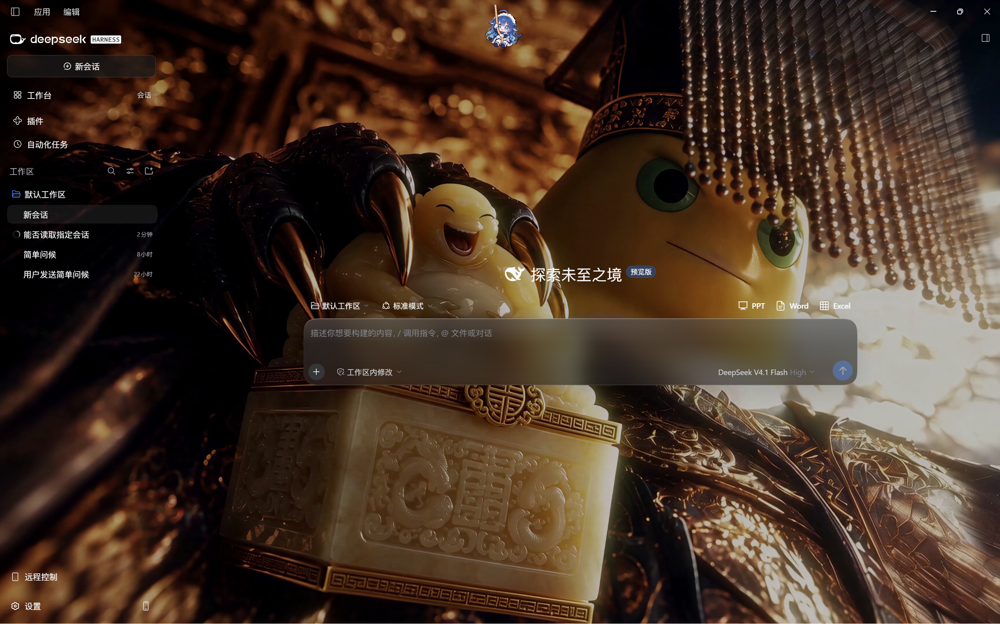

# dsh-wallpapers

## 用户原图预设 · 奶皇新（v0.2.0）

下面是用户提供的**真实 DSH 首页截图**。它是复刻目标，没有重画成示意网页：



### 本版怎么实现

v0.1.0 重新实现了一套相近的玻璃 CSS，预览还用了虚构布局，与用户的要求不符。v0.2.0 已移除这套 CSS、独立视频层和示意图，改成**原插件的原图参数预设**：

- 继续由 `dsh-plugin-wallpaper-engine@1.4.0` 渲染背景、玻璃、输入框、边框和挂件。
- 保留 DSH 的真实首页、聊天页、侧栏和插件页结构。
- 保存用户原图对应的原生深色主题及 121 个可移植参数，而不是再猜一组样式。
- 安装本插件本身不会改界面。需要在“设置 → 原图主题”点击“应用原图效果”，然后刷新当前页。
- 应用前保存参数备份；应用失败会尝试回滚。恢复时保留应用后手动改过的参数。

视频播放帧、窗口大小、系统缩放与 DSH 版本会影响像素位置。因此这里提供**同源渲染与同参数**，不承诺不同屏幕上的每个像素都一致。

### 安装条件

1. 兼容 0.2 内核的 DSH Web / DSH Desktop。
2. 先安装并正常启用原壁纸插件 `dsh-plugin-wallpaper-engine@1.4.0`。本插件是预设扩展，不重复实现或替代它。
3. 本机已下载“奶皇新”，创意工坊 ID：`3808236079`。

创意工坊地址：<https://steamcommunity.com/sharedfiles/filedetails/?id=3808236079>

请取得本地视频后再应用预设。本插件不会启动 Wallpaper Engine 桌面程序，也不会订阅或切换系统桌面壁纸。

### 安装和应用

1. 下载 [`dist/dsh-amber-glass-theme-0.2.0.tgz`](dist/dsh-amber-glass-theme-0.2.0.tgz)。
2. 在 DSH 插件市场的自定义安装源中使用本地安装包路径。通过包管理器手动安装时，在**当前 profile 目录**执行 `pnpm add /absolute/path/dsh-amber-glass-theme-0.2.0.tgz`，并将包名加入该 profile 的 `dsh.profile.bundles`。
3. 打开 **设置 → 原图主题 → 应用原图效果**。
4. 点击 **刷新当前页**，由原壁纸插件读取刚保存的参数。不需要重启软件。

若从 v0.1.0 升级，宿主卸载旧版本后，其近似样式将被移除。v0.2.0 也会主动清理旧客户端控制器。

### 恢复和数据

“恢复应用前设置”读取本插件的本地备份。它仅恢复仍等于本预设值的参数，保留后续手动调过的参数。原字体集文档不会被改写；预设使用独立的字体集。

备份位于 `~/.dsh-amber-glass-theme/original-preset-backup.json`。保留此文件即可保留恢复依据。卸载本预设扩展不会自动撤销已经应用到原壁纸插件中的参数，需要恢复时请先使用恢复按钮。

仓库仅包含代码、可移植主题参数和用户提供的截图，不包含视频、模型配置、账号凭据或个人本地路径。

### 开发与验证

```sh
npm run build
npm test
npm pack
```

无第三方运行时依赖。原壁纸插件是兼容性前提，通过 `peerDependencies` 声明。验证范围详见 [docs/VALIDATION.md](docs/VALIDATION.md)。

代码为 MIT 许可。原壁纸插件、挂件与视频的实现/资产属于各自作者；本仓库通过配置复用原插件，不复制其渲染实现或视频。原项目：<https://github.com/elysia395/dsh-wallpaper-engine>。
