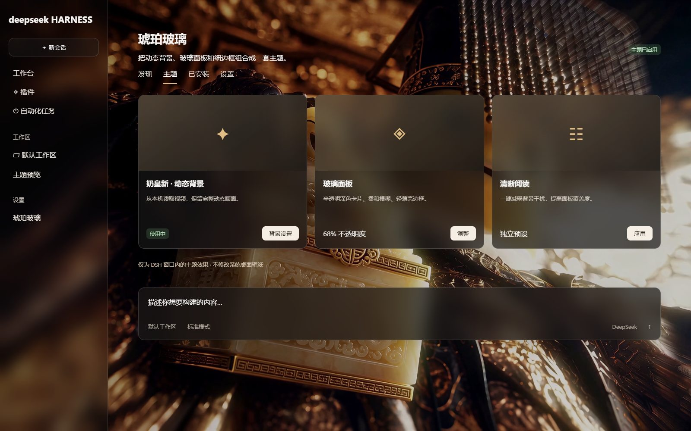

# dsh-wallpapers

## 琥珀玻璃 · DSH Amber Glass

把“奶皇新”动态背景与半透明侧栏、玻璃面板、细边框和圆角组合成一套可安装的 DSH 主题。



## 功能

- DSH 窗口内的循环视频背景，默认静音。
- 截图风格：琥珀背景、深色半透明卡片、细亮边框、轻微玻璃模糊。
- 可独立调节背景可见度、亮度、暗化、面板/侧栏不透明度、模糊与圆角。
- “清晰阅读”预设与“恢复原界面”按钮。
- 停用或卸载时移除本插件的样式、背景、事件和定时器。
- 自动查找 Steam 中已下载的“奶皇新”，也可指定其他本地 MP4 / WebM。

这是一份独立实现的 DSH 主题。它不调用 Wallpaper Engine 桌面控制接口，不切换 Windows 桌面背景，也不改动原壁纸插件的配置。截图中的桌宠来自其他插件，不包含在本插件中。

## 使用条件

- DeepSeek Harness 0.2 内核的 Web GUI 或兼容的 DSH Desktop。
- Node.js 22.12 或更高版本；桌面版使用宿主内置运行时。
- 背景视频在本地。仓库不包含视频本体。

“奶皇新”创意工坊地址：
<https://steamcommunity.com/sharedfiles/filedetails/?id=3808236079>

建议先完成订阅与下载，再启用本插件。若希望系统桌面完全不受影响，可直接在本插件中填写已下载视频的完整路径；无需打开 Wallpaper Engine 窗口或选择系统桌面壁纸。

## 安装

本仓库为私有仓库，只有获授权的 GitHub 账号能访问。

1. 下载仓库中的 `dist/dsh-amber-glass-theme-0.1.0.tgz`，或者下载本次提供的安装包。
2. 在 DSH 插件市场的自定义安装源中选择/填写本地安装包路径。使用命令行的宿主，也可在**当前 profile 目录**执行：

   ```sh
   pnpm add /absolute/path/dsh-amber-glass-theme-0.1.0.tgz
   ```

3. 若通过包管理器手动安装，在该 profile 的 `package.json` → `dsh.profile.bundles` 中加入 `dsh-amber-glass-theme`。通过插件市场安装时由宿主管理这一项。
4. 在 DSH 的“设置 → 琥珀玻璃”中应用截图风格。

私有 GitHub 安装源是否可直接安装，取决于宿主的 GitHub 登录配置。本地 `.tgz` 安装不依赖公开下载地址。不要将 GitHub 令牌粘贴到安装源或配置文件中。

## 调整与恢复

“背景可见度”越低，背景越淡；“面板不透明度”越高，面板越实。它们使用不同名称，避免把透明度方向弄反。

“恢复原界面”关闭本主题。启用时，已有壁纸插件的背景仅被临时隐藏；本主题关闭后恢复显示，不覆盖已有插件的配置。主题参数保存于本机 `~/.dsh-amber-glass-theme/settings.json`。

## 开发

无第三方运行时依赖，构建和基础测试只使用 Node.js 内置模块。

```sh
npm run build
npm test
npm pack
```

`src/host.js` 提供本地配置和视频读取；`src/client.js` 注册 DSH 设置分区并管理主题生命周期；`src/theme.css` 包含作用域样式。生成的 `lib/client.js` 已随安装包提交，普通使用者无需自行构建。

标准槽位、侧栏和输入卡片使用 DSH 的 `data-*` 锚点。插件市场部分卡片保留了类名兼容选择器；未来宿主改变卡片结构时，可能需要更新这些选择器。

## 资产与授权

代码使用 MIT 协议。“奶皇新”视频及其角色、音画素材属于原作者，需通过创意工坊或其他获授权途径获取；视频不随代码许可转授权。预览图为虚构内容的示意界面，用于展示主题效果。仓库不上传个人会话、模型密钥、本机配置或本地视频路径。
